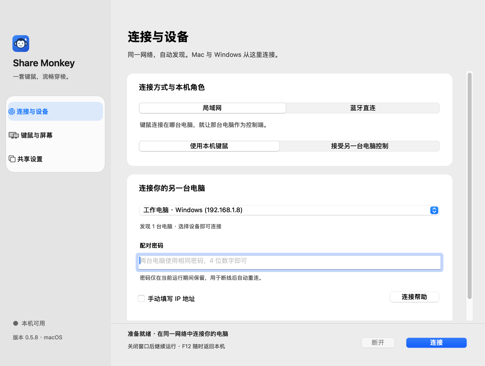

# Share Monkey


macOS / Windows 键鼠共享软件。一套键鼠在两台电脑之间跨屏使用，可选择局域网或蓝牙直连。与商业 ShareMouse 软件无关联。

当前 Mac / Windows 构建均为 **0.5.8**。支持 4 位配对密码、断线自动恢复和 Windows 关屏保活请求；保留 0.5.7 的原生事件引用泄漏修复。验证范围见 [验证说明](docs/VALIDATION.md)。尚未完成真实 Windows 关屏/唤醒及双机耐久验收。



## 直接安装

安装包见 [0.5.8 预发布下载页](https://github.com/wecomed/Share-Monkey/releases/tag/v0.5.8)。请同时更新两端；本版验证范围及未完成的实机验收见发布说明。

| 系统 | 直接下载 |
| --- | --- |
| macOS · Apple Silicon | [Mac 安装包（ZIP）](https://github.com/wecomed/Share-Monkey/releases/download/v0.5.8/Share-Monkey-0.5.8-Mac.zip) |
| Windows 11 · x64 | [Windows 安装器（EXE）](https://github.com/wecomed/Share-Monkey/releases/download/v0.5.8/Share-Monkey-0.5.8-Windows-Setup.exe) |
| 两端合包 | [macOS + Windows（ZIP）](https://github.com/wecomed/Share-Monkey/releases/download/v0.5.8/Share-Monkey-0.5.8-macOS-Windows.zip) |
| 文件校验 | [SHA256SUMS.txt](https://github.com/wecomed/Share-Monkey/releases/download/v0.5.8/SHA256SUMS.txt) |

源码仓库不包含安装器、Python 环境或本地构建缓存；自行构建时输出位于 `dist/v0.5.8/`。

- **Mac**：打开 `Share Monkey.app`；也提供 `Share-Monkey-0.5.8-Mac.zip`。无需安装 Python。本次构建适用于 Apple Silicon。
- **Windows 11 x64**：运行 `Share-Monkey-0.5.8-Windows-Setup.exe`。自带 Python 3.12.10、Qt 和键鼠依赖，不需要另外安装 Python，也不需要管理员权限。
- 升级前先退出旧客户端；已经有常驻图标的版本需从图标菜单选择“退出 Share Monkey”。旧应用与 v0.3.2 的发行目录均保留。
- 应用尚未使用发布者证书签名；Mac 为本地临时签名，未公证，Windows 安装器未 Authenticode 签名。

Windows 默认安装到 `%LOCALAPPDATA%\Programs\Share Monkey`，创建桌面及开始菜单快捷方式，并登记到“已安装的应用”以便卸载。安装器不修改全局 Python、PATH、防火墙或开机启动。两端都可以选择控制端或接收端。

## 常驻运行与界面

Mac 使用 **AppKit 原生界面**、系统字体和中文字体回退；支持系统深浅色，macOS 27 上采用原生 `NSGlassEffectView` 导航材质。点左上角红色关闭按钮或按 Command-W 只隐藏主窗口，保留菜单栏及 Dock 图标、连接和键鼠监听。远控期间打开主窗口，会先安全返回本机，再显示窗口，连接继续保持。只有“退出 Share Monkey”或 Command-Q 才真正退出。连接或等待期间持有允许系统正常睡眠的 `NSProcessInfo` 活动，避免 App Nap 暂停共享；系统睡眠后的重新连接仍按下文操作。

Windows 使用 **Qt Widgets** 实现遵循 Windows 11 风格的界面，包含圆角分组、Fluent 式开关、深浅色、Mica 标题栏和系统缩放。字体优先 Segoe UI Variable Text / Segoe UI，中文回退 Microsoft YaHei UI。这不是 WinUI 3 实现。关闭窗口后保留通知区图标；通知区暂不可用时退回最小化窗口。Windows 可自行把图标收纳到通知区的隐藏图标列表。

关闭窗口与退出程序分开；重新打开软件会唤回现有窗口。默认开启“断线自动恢复”：网络或蓝牙暂时中断后，两端自动恢复等待与连接，重试间隔依次为 1、2、4、8 秒，最多 15 秒（每次实际连接还可能需要扫描和握手时间）。先释放旧按键、鼠标与监听，再重新建立加密会话；重连成功后处于本机状态，重新跨屏即可操作。点击“断开”或退出会取消重连。密码错误或权限错误需修正后手动连接。

Windows 默认开启“关屏保持共享”，共享或重连期间持有系统/执行电源请求，不要求显示器保持亮屏，不修改电源计划；可在“共享设置”关闭。使用 [Windows PowerSetRequest](https://learn.microsoft.com/en-us/windows/win32/api/winbase/nf-winbase-powersetrequest)。用户主动睡眠、合盖和 Modern Standby 的电池策略仍可暂停进程/蓝牙，恢复后自动重连；不承诺真正睡眠期间仍可通信。

角色、方向、速度、共享偏好与设备标识保存在用户自己的 `Share Monkey/settings.json` 中。配对密码仅在当前运行期间保留在内存中以便自动重连，不保存到磁盘；退出软件后需重新输入。自动重连核对已配对设备的加密身份字段，并可根据带设备标识的广播重新发现变化后的 Mac 蓝牙地址。接收文件保存到 `Downloads/Share Monkey`；旧下载文件不会搬移。

## 局域网连接

1. 两台电脑连接同一局域网，准备相同配对密码，4 位数字即可，也可继续使用更长密码。
2. 没有连接键鼠的电脑：在“连接与设备”选择“接受另一台电脑控制”，输入密码并点击“开始等待”。
3. 连接键鼠的电脑：选择“使用本机键鼠”，选择自动发现的设备并输入相同密码。只有一台设备时自动选中，无需填 IP。
4. 在“键鼠与屏幕”选择对方位于左侧还是右侧，然后连接；将鼠标移到对应边缘即可跨屏。移回入口边缘或按 F12 返回本机。
5. 鼠标速度范围 25%–400%，支持连接时即时调整并按 DPI 换算。Mac 默认 150%，Windows 默认 100%。其他连接 / 共享设置需先断开再调整。
6. “共享设置”可切换文本剪贴板、文件接收和 Command / Control 映射。通过“选择文件并发送…”传送文件，对方需提前允许接收。
7. 关闭主窗口可继续使用；需要真正退出时使用菜单栏或通知区图标里的“退出 Share Monkey”。

Mac 需在“系统设置 → 隐私与安全性”允许客户端的“辅助功能”和“输入监控”，授权后退出重开。系统询问本地网络访问时请允许。应用保留原 bundle ID，但如果更新后权限失效，请重新添加新版应用。源码启动时，授权实际运行它的终端 / Python。

Windows 防火墙提示时允许专用网络。连接使用 TCP 24809，自动发现使用 UDP 24810。访客 Wi-Fi、AP 隔离或屏蔽广播的网络可能无法发现，此时可勾选“手动填写 IP 地址”。发现设备不代表信任，实际控制仍需密码加密配对。

## 蓝牙直连的配置

本轮 4 位密码和自动重连需要两端都更新到 **v0.5.8**。Mac 保留内存、系统按键崩溃、进入时不跳回及窗口常驻修复；Windows 保留远控期间的快速连接请求。Mac 和 Windows 11 都需要可用的低功耗蓝牙（BLE）；Windows 适配器及其驱动需要支持 BLE 中央设备模式。蓝牙模式不需要同一 Wi-Fi、IP 地址、COM 端口或更改防火墙。

蓝牙传输协议仍为第 3 版，使用原长度密码时可与 v0.5.2–v0.5.7 通信；这些旧版不支持 4 位密码或完整的双端自动恢复。升级时请从常驻图标菜单真正退出旧版，再打开新版；单纯关闭窗口只会隐藏旧进程。

Windows 0.5.4 借用当前连接的 WinRT 设备，远控期间请求系统的 ThroughputOptimized 参数；返回后保留 5 秒，连续跨屏复用同一请求，空闲或断开时释放。系统、驱动和其他蓝牙设备仍可能限制实际结果，日志记录真实协商间隔，不能把请求成功当成延迟已经达标。使用的是 [Windows 官方连接参数接口](https://learn.microsoft.com/en-us/uwp/api/windows.devices.bluetooth.bluetoothledevice.requestpreferredconnectionparameters?view=winrt-26100)，不修改注册表或全局蓝牙设置。

1. 退出旧客户端，打开新版，在两台电脑的系统设置里开启蓝牙。
2. 两端进入“连接与设备”，把“连接方式”改为 **蓝牙直连**。
3. 键鼠实际接在哪台电脑，哪台选择 **使用本机键鼠**；另一台选择 **接受另一台电脑控制**。两端输入相同的配对密码，4 位数字即可；这是 Share Monkey 的密码，不是系统蓝牙 PIN。连接前，先在使用本机键鼠的一端进入“键鼠与屏幕”，设好对方位于左边还是右边。
4. **先在 Mac 点击“开启蓝牙等待”**。系统询问蓝牙访问时允许 Share Monkey。被拒绝时，在“系统设置 → 隐私与安全性 → 蓝牙”重新允许，然后退出重开客户端。
5. Windows 会自动查找附近的 Share Monkey。选择列表中的 **SM Monkey + 设备标识**，点击 **连接 Mac**。有多台 Mac 时暂时只让目标 Mac 开启等待。无需先去系统的“添加蓝牙设备”配对，也无需添加成蓝牙键盘或鼠标。
6. 两端显示“蓝牙已连接”后，鼠标移到刚才设定的边缘即可切换；F12 返回本机。若需修改左右位置，请先断开连接。Mac 的“辅助功能”和“输入监控”权限仍然需要。

Mac 固定提供蓝牙服务，Windows 固定发起连接；**控制方向仍由两端角色决定**，Mac 或 Windows 都可以使用本机键鼠控制对方。暂时断线后，Mac 自动重新开启等待，Windows 自动重新连接；主动“断开”或退出软件时停止重连。

蓝牙模式支持键盘、鼠标、滚轮和 **最多 8 KiB（8192 UTF-8 字节）的纯文本剪贴板**。文本按小块传输，输入消息优先，全部收齐后才更新剪贴板；新复制的内容会替换尚未发完的旧内容。超过上限的文本会显示“未同步”。文件、图片和富文本不经蓝牙传输；发送文件或大段文本请先断开并切回局域网。

蓝牙连接失败时，先看窗口底部状态及“蓝牙配置”帮助。常见原因是 Mac 权限被拒绝、Windows 蓝牙关闭、适配器 / 驱动不支持 BLE、两端密码或角色不匹配、Mac 未开启等待。无需为此修改路由器或开放端口。

蓝牙鼠标按最新绝对位置更新，DPI 换算、屏幕裁剪和回程边界在控制端逐次计算；点击和按键仍保留各自之前的位置，不跨越它们合并。回程边缘有约 8 个逻辑像素的容差，减少刚进入时轻微反向手势触发来回跳。F12 或到达返回边缘时，会先等待接收端隐藏指针并释放按键，随后恢复源端指针；确认超时则断开恢复本机。接收端再次进入时先定位再显示，避免旧光标闪跳。

Mac 控制对方时会围绕实际指针位置临时激活透明捕获窗口。原生捕获完成后重新读取实际冻结位置，只移动面板以覆盖指针，避免异步激活期间过时的坐标导致断线。取得实际前台焦点、空白光标及原生捕获后才通知对方显示指针；进入过程中不主动移动本机指针，避免下一硬件事件混入定位位移并误触发返回。返回时恢复原应用，不重新打开已隐藏或最小化的主窗口。用户或系统切走捕获焦点时会通过正常返回回执恢复本机、保留连接；输入监听、光标恢复等真实故障仍会断开以确保本机可用。

蓝牙最多允许两条等待对端处理的有效载荷，其中剪贴板最多一块；本机蓝牙接口返回成功不会提前释放额度。旧位置在应用队列中合并，避免持续灌入系统队列。剪贴板使用 32 字节的小块，在控制端鼠标或键盘操作结束 150 ms 后才继续传输。Windows 定位使用物理像素坐标并检查系统 API 是否成功。

客户端自动保留最近 10 次连接的聚合性能日志，每份最多 1 MiB。Mac 位于 `~/Library/Application Support/Share Monkey/logs/`，Windows 位于 `%LOCALAPPDATA%\Share Monkey\logs\`。日志记录本地发送耗时、对端处理回执往返和队列数量，不记录按键、坐标、剪贴板或密码。回执耗时不等于单向无线延迟或屏幕显示延迟。

Windows 的系统指针由独立光标守护进程管理，父程序退出、IPC 断开或隐藏租约超时会尝试恢复系统指针，不替换系统光标文件或资源。接收端待机隐藏时，使用它自己的物理鼠标可恢复本机指针。

Mac 蓝牙请使用本次生成的 **Share Monkey.app**。直接用普通终端运行 Python 时通常缺少应用蓝牙用途声明，客户端会拒绝启动蓝牙，避免 macOS 因缺少 `NSBluetoothAlwaysUsageDescription` 结束进程；此时请构建并运行 `.app`。普通源码运行的局域网模式仍可使用。

## 功能边界

目前每端支持一个主显示器；支持鼠标、键盘、点击、滚轮。局域网支持文本剪贴板（256 KiB）和普通文件（100 MB）；蓝牙剪贴板上限 8 KiB，不传文件。局域网保留 PBKDF2 和双向 Fernet 会话加密；蓝牙第 3 版在紧凑 AES-GCM 帧上增加处理回执，使用双方随机握手、独立方向密钥与消息序号认证。文件接收后校验 SHA-256。连接时不会主动同步原有剪贴板内容。允许接收文件后不会逐个弹窗确认，接收文件不会自动打开。

尚不支持多显示器拓扑、桌面文件拖拽、图片 / 富文本剪贴板、系统登录界面或 Windows UAC 安全桌面。F12 被预留用于返回本机。中文输入依赖接收端输入法。

## 源码运行和构建

源码运行需要 Python 3.11+。Mac 使用项目 `.venv/bin/python`，Windows 使用 `.venv\Scripts\python.exe`：

```sh
python -m pip install -r requirements.txt
python -m sharemouse
```

也可以使用 `run-macos.command` / `run-windows.bat`。开发 Mac 已有项目专用 Python 3.12.11 和虚拟环境；不修改系统 Python。

构建依赖在 `requirements-build.txt`，Mac 应用需在 Mac 上构建：

```sh
.venv/bin/python -m pip install -r requirements-build.txt
.venv/bin/python tools/build_client.py macos --output-dir dist/v0.5.8
```

Windows 安装器可在 Mac、Linux 或 Windows 上构建。它组合官方 Windows embeddable Python、经过 SHA-256 校验的 Windows wheels、GUI EXE 启动器与 NSIS 安装器，不把 Mac 二进制放进 Windows 程序：

```sh
.venv/bin/python tools/build_windows_installer.py --output-dir dist/windows-dev
.venv/bin/python tools/check_windows_payload.py
```

Mac / Linux 缺少 NSIS 时，脚本从官方发布包验证哈希后构建本地编译器；Windows 上需安装 NSIS 并使其可被找到。Windows 也可用 `tools/build_client.py windows` 生成 PyInstaller 便携文件夹。`tools/export_clients.py` 导出两端源码 ZIP，源码 ZIP 与直接安装的 EXE 是不同文件。

## 验证

统一入口及各层验证范围见 [稳定性验收](validation/README.md)。推荐先运行：

```sh
.venv/bin/python tools/verify_release.py --profile quick --output-dir validation/stability/quick
```

该入口保存各项 JSON、日志及统一报告；缺失、跳过、中断、过时、版本不匹配都不能变成发布通过。Windows 提供复用现有 Python 的一键自检包；模型 / Mac 原生长跑与真实双机 BLE 耐久分别标记。

以下专项工具仍可单独运行：

```sh
.venv/bin/python -m unittest discover -s tests -v
.venv/bin/python tools/check_desktop_ui.py macos
QT_QPA_PLATFORM=offscreen .venv/bin/python tools/check_desktop_ui.py windows
.venv/bin/python tools/check_windows_payload.py
```

界面自动检查不连接网络、不启用蓝牙、不安装输入钩子，不保存用户偏好；用测试引擎验证关闭窗口不停止连接。蓝牙集成测试通过实际加密通道及模拟 GATT 分片，覆盖两种控制方向和连续跨屏。模拟测试与 PE / DLL / 文件哈希检查不能代替真实 Windows 界面、适配器、无线延迟及安装验证。详细范围见 [验证说明](docs/VALIDATION.md)。开发机器上的原始日志、崩溃记录、配对信息和设备快照不纳入公开仓库。

## 许可证

项目尚未指定开源许可证。第三方组件的许可证与来源见 [第三方声明](THIRD_PARTY_NOTICES.md)。
